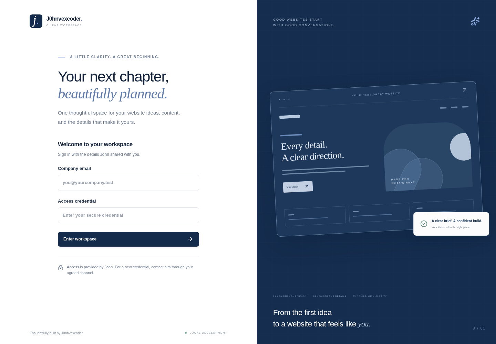
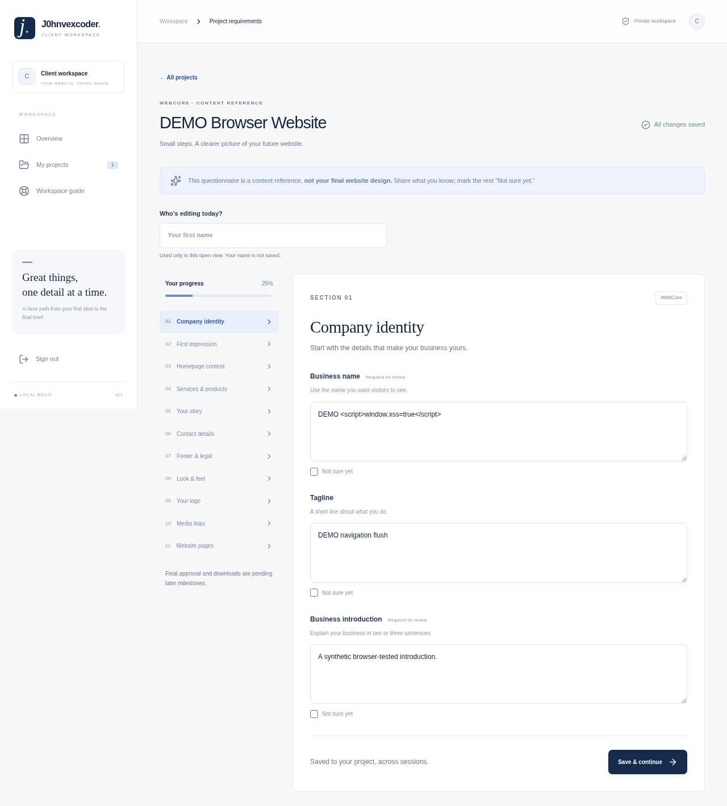
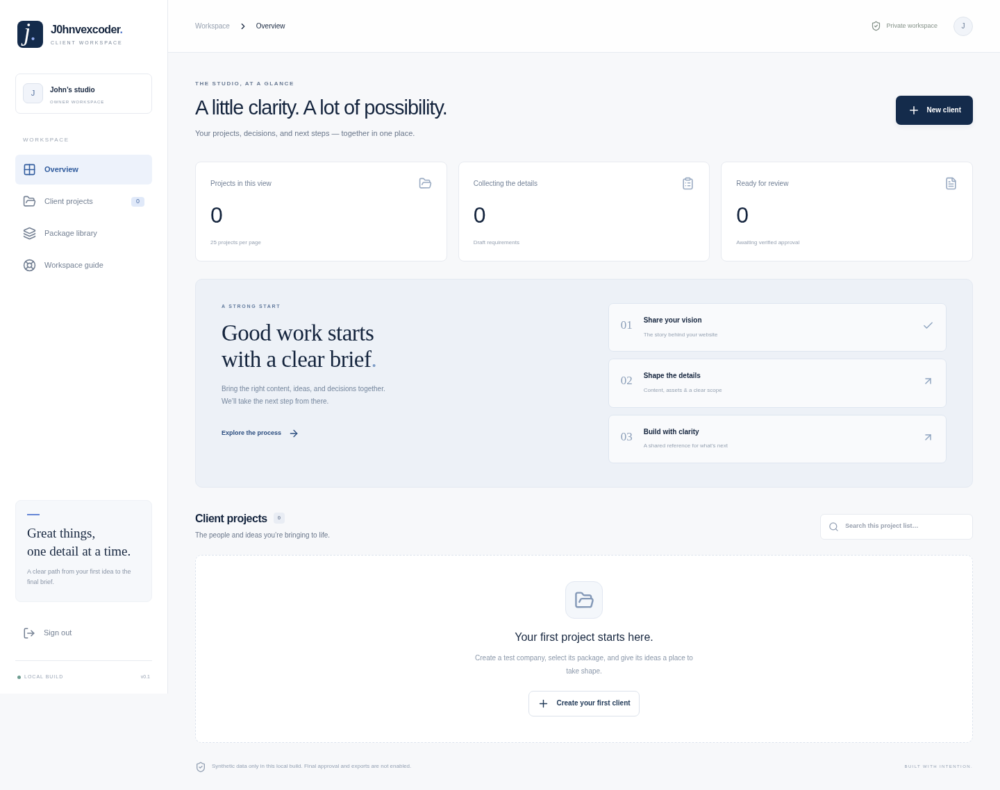

<div align="center">
  

# Johnvexcoder Client Portal

**A clearer brief. A smoother build.**

A private workspace that turns website ideas, content and decisions into an organized project brief — from the first conversation to the final review.

[Portfolio](https://johnvexcoder.github.io/) · [Screenshots](#screenshots) · [Deployment](#deployment) · [Credits](#credits)


</div>

## The problem

Website projects often begin with scattered chat messages, missing content and repeated questions. Clients struggle to see what is needed, while the developer has to track decisions, clarify scope and keep approved requirements separate from later requests.

## How this project solves it

The portal gives clients and the developer one shared place to move the project forward.

| For clients                                            | For the developer                                           |
| ------------------------------------------------------ | ----------------------------------------------------------- |
| A guided questionnaire shaped by the purchased package | A protected admin workspace with MFA                        |
| Autosaved answers, progress and “Not sure yet” options | Client provisioning, package assignments and scope controls |
| Contextual questions and change requests               | Project inbox, private notes and audit history              |
| Versioned requirements and website checkups            | Immutable approval records and structured JSON exports      |
| One login that opens their own company workspace       | Server-controlled roles and company isolation               |

The animated sign-in uses the portfolio's J mark, motion controls and reduced-motion support. Public Privacy and Terms pages display owner-published wording; unpublished drafts stay private.

## Screenshots

These genuine screenshots document an earlier local development build using synthetic test data. The login has since been redesigned; updated captures are pending browser access.

### Login page



### Client workspace



### Admin panel



## Deployment

> **Current status:** local development is supported; production release is still gated. Hosted authentication/MFA performance, finished PDF export, browser/accessibility checks and interactive backup recovery need validation. Nonlocal APIs deliberately return 503 until the production runtime is reviewed and enabled. Publishing the current build or changing an environment variable does not clear that gate.

### Run locally

Install **Node.js 22.12+**, npm and Git. Linux/Fedora users also need a working browser and an authenticator for owner MFA. Python 3 is used by backup integrity checks.

```sh
git clone https://github.com/johnvexcoder/Johnvexcoder-Client-Portal.git
cd Johnvexcoder-Client-Portal
npm ci
npm run db:migrate:local
npm run auth:bootstrap
npm run dev
```

Open **http://localhost:5173**. The one-time bootstrap asks for a synthetic `.test` owner email and a hidden password of at least 16 characters, then creates a private local authentication secret. There are no default credentials. Existing owners skip bootstrap.

Use the same login form for admins and clients. The server reads the account role and opens the appropriate dashboard. The owner enrolls an authenticator and saves backup codes, then provisions synthetic client accounts. Clients must replace their temporary credential on first use. No Cloudflare account is needed for local development.

Run the local checks before releasing changes:

```sh
npm run typecheck
npm run lint
npm test
npm run test:integration
npm run format:check
npm run build
npm run secrets:scan
npm run release:check
```

`release:check` reports recorded release gates and currently exits with status 1. It does not rerun the checks or enable production. Actual hosted Worker CPU measurements are needed; local timings do not establish free-tier compatibility. Finished PDF export is pending; frozen print references and admin JSON exports are available.

### Cloudflare setup — shared by both deployment methods

Complete the release gates and review the production runtime change **before running remote deployment steps**. Use a separate production database and secret. The intended host is Cloudflare Workers with D1; free-tier quotas and CPU limits apply.

1. Sign in to Cloudflare and create a D1 database:

   ```sh
   npx wrangler login
   npx wrangler d1 create johnvexcoder-client-portal
   ```

   Copy the returned database UUID. Decline any offer to replace the local development configuration.

2. Choose the final HTTPS portal address, such as `https://johnvexcoder-client-portal.YOUR-SUBDOMAIN.workers.dev`, using your actual Cloudflare subdomain.

3. Generate the separate production configuration and private owner setup files:

   ```sh
   npm run deployment:prepare
   ```

   Enter the Worker name, database UUID, exact HTTPS origin, owner email and hidden password. This offline helper creates `wrangler.production.jsonc`, `.deployment/secrets.env` and `.deployment/bootstrap.sql`. It refuses to overwrite existing files. The `.deployment` directory contains private setup material and must never enter Git.

4. Review the production database ID, then initialize it:

   ```sh
   npx wrangler d1 migrations apply DB --remote --config wrangler.production.jsonc
   npx wrangler d1 execute DB --remote --config wrangler.production.jsonc --file .deployment/bootstrap.sql
   ```

   This creates the schema, package catalog and owner account. Preserve the same bootstrap file if a retry is needed; it does not replace an existing owner or reset its password. Do not import a development database into production.

### Deploy without GitHub

After the production runtime gate has been cleared:

```sh
npm run build:cloudflare
npx wrangler deploy --secrets-file .deployment/secrets.env
```

Deploy immediately after the production build from the same directory. Wrangler uses the Vite-generated configuration to publish the Worker and frontend together. For later releases, repeat the checks, apply reviewed new migrations when required, then build and deploy again. Owner bootstrap is a one-time setup.

### Deploy with GitHub

Use the same one-time setup above. Make the first approved deployment directly, then connect the existing Worker to this repository for future releases.

1. Commit `wrangler.production.jsonc`; it contains configuration, not the application secret. Keep `.deployment/`, `.dev.vars`, backups and local databases out of Git.
2. Create a dedicated `production` branch for reviewed releases.
3. In Cloudflare, open **Workers & Pages → your Worker → Settings → Builds** and connect this repository.
4. Select the `production` branch and configure:

   | Setting        | Value                           |
   | -------------- | ------------------------------- |
   | Root directory | Repository root                 |
   | Build command  | `npm run build:cloudflare`      |
   | Deploy command | `npx wrangler deploy`           |
   | Node version   | A supported Node 22.12+ version |

5. Confirm `BETTER_AUTH_SECRET` exists in the Worker's **runtime Variables & Secrets**. Build variables and runtime secrets are separate. Leave preview deployments disabled until they have an isolated database and secret.
6. Push a reviewed release to the connected branch. Apply database migrations as a separate reviewed step.

Cloudflare references: [Vite deployment](https://developers.cloudflare.com/workers/vite-plugin/get-started/), [D1 setup](https://developers.cloudflare.com/d1/get-started/), [Worker secrets](https://developers.cloudflare.com/workers/configuration/secrets/), [GitHub builds](https://developers.cloudflare.com/workers/ci-cd/builds/configuration/) and [Worker limits](https://developers.cloudflare.com/workers/platform/limits/).

### First sign-in and ongoing care

Sign in at the deployed portal address using the owner credentials chosen during preparation. Complete MFA and save the backup codes privately. In **Admin settings**, supply and publish reviewed Privacy/Terms wording and versions, complete the project approval agreement and verification procedure, and set CMS caps, retention periods and backup cadence before onboarding real clients.

Verify client isolation, sign-in, recovery, autosave, approvals and exports using synthetic accounts first. Monitor Worker CPU/errors and D1 quotas. A **503 / local development only** response means the release gate is still closed; a **1102** error requires CPU investigation. Do not weaken password hashing to work around runtime limits.

For local backup rehearsal:

```sh
npm run db:backup:local
npm run db:restore:check -- backups/YOUR_BACKUP.sql
```

Preserve the matching application secret securely alongside encrypted backups; MFA recovery depends on it. Test interactive login after restoration. Production backups must target the production database explicitly. Keep the previous code release and database backup available: rolling back code does not reverse migrations.

## Credits

Created for and dedicated to **John Dexcoder — J0hnvexcoder**.

Product vision, brand identity and creative direction by **J0hnvexcoder**.

[Portfolio](https://johnvexcoder.github.io/) · [GitHub](https://github.com/johnvexcoder)
